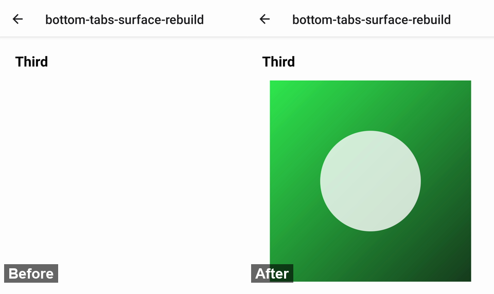

# bottom-tabs-surface-rebuild

**Library:** `@react-navigation/bottom-tabs` 7.21.0 (JS tabs, `7.x` branch) with `react-native-screens` 4.30.0
**Platform:** Android. Measured on a Redmi Note 8 Pro, release build.

## Steps

1. `npx expo run:android --variant release`, open **bottom-tabs-surface-rebuild**.
2. Visit the three tabs once, then switch between them.
3. Watch `adb logcat -s SkiaTextureView`.

## Expected

With `detachInactiveScreens={false}` the scenes stay attached, so a tab's `TextureView` (Skia here; WebGPU and video
behave the same) keeps its surface across switches.

## Actual

Every switch to a tab recreates its surface (`onSurfaceTextureAvailable`). With `detachInactiveScreens` off,
`MaybeScreen` still gets the inactive `activityState`, and the disabled `react-native-screens` `Screen` renders an
inactive screen with `display: none`, which takes the scene off the window.

| 12 switches between mounted tabs | `7.21.0` | `fix/bottom-tabs-surface-rebuild` |
| --- | --- | --- |
| surfaces recreated | 12 (2 runs: 12, 12) | 0 (2 runs: 0, 0) |
| janky frames | 3.8% (11 frames) | 0% |
| 99th percentile frame | 27–29 ms | 11 ms |

The first frame after each switch shows the tab with its canvas missing (5 switches out of 5 in a
recording, 0 with the fix):

Unfocused scenes stay out of the accessibility tree in both builds (`uiautomator dump --compressed`): the scene's
`aria-hidden` from `@react-navigation/elements` already hides them.
