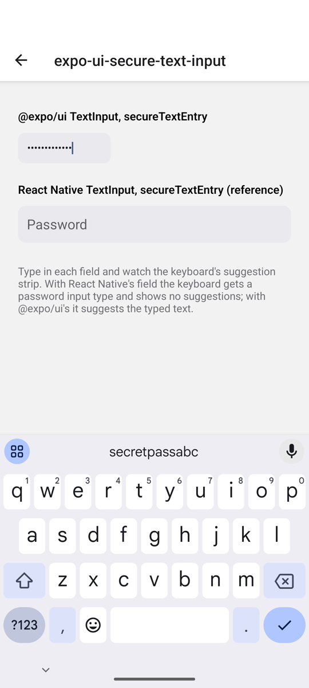
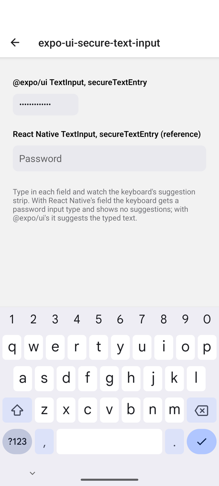

# expo-ui-secure-text-input

**Library:** `@expo/ui` 58.0.21 (also `main`), universal `TextInput`
**Platform:** Android (Gboard on an API 36 emulator)

## Steps

1. `npx expo run:android`, open **expo-ui-secure-text-input**.
2. Tap the first field (`@expo/ui` `TextInput` with `secureTextEntry`) and type `secretpassabc`.
3. Look at the keyboard's suggestion strip.
4. Do the same in the second field (React Native `TextInput` with `secureTextEntry`) for reference.

## Expected

A secure field is a password field for the keyboard: no suggestions, nothing learned. React Native's field gets `inputType=0x4081` (text, password variation).

## Actual

The `@expo/ui` field masks the text on screen, but the keyboard gets `inputType=0x8001` (plain text with autocorrect). Gboard shows `secretpassabc` in its suggestion strip and can learn it.

Check the input type with:

```sh
adb shell dumpsys input_method | grep -m1 -o 'inputType=0x[0-9a-f]*'
```

| Before | After (`fix/expo-ui-secure-text-input`) |
| --- | --- |
|  |  |

## Why

`src/universal/TextInput/index.android.tsx` maps `secureTextEntry` only to `visualTransformation: 'password'`, which masks the text. `keyboardOptions.keyboardType` stays `text`, and `autoCorrectEnabled` is not set, so Compose reports a plain text field to the keyboard.

## Upstream

- Issue: https://github.com/expo/expo/issues/52009
- PR: https://github.com/expo/expo/pull/52010
- Fix branch here: `fix/expo-ui-secure-text-input`
