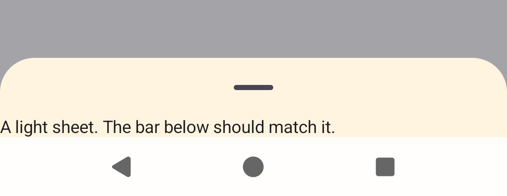
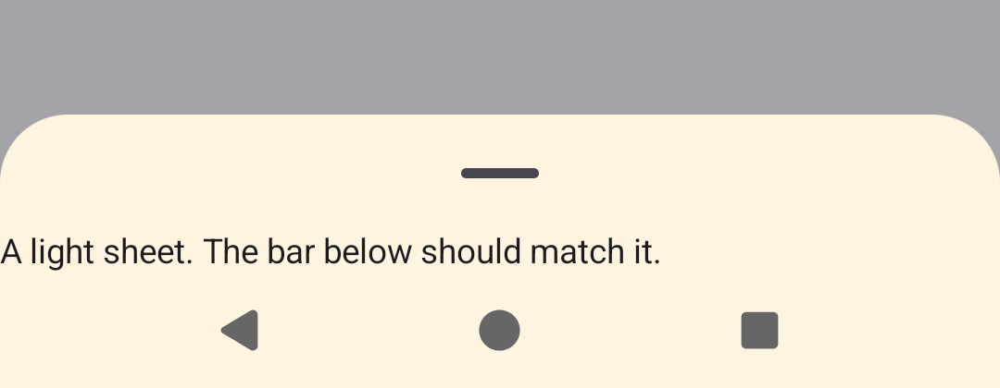

# expo-ui-sheet-nav-bar

**Library:** `@expo/ui` 58.0.21 (also `main`), Jetpack Compose `ModalBottomSheet`
**Platform:** Android 15+ (API 36 emulator), 3-button navigation

## Steps

1. Switch the emulator to 3-button navigation: `adb shell cmd overlay enable com.android.internal.systemui.navbar.threebutton`.
2. `npx expo run:android --variant release`, open **expo-ui-sheet-nav-bar** (or `adb shell am start -d reprolab://demo/expo-ui-sheet-nav-bar`).
3. Tap **Open a cream sheet (#FFF4E0)** and look at the navigation bar under the sheet.
4. Do the same with **Open a dark sheet (#1C1C1E)**.

`@expo/ui` must be built from source for a local change to apply: `package.json` sets `expo.autolinking.android.buildFromSource: ["expo-ui"]` (the package otherwise ships a prebuilt AAR).

## Expected

The navigation bar shows the sheet's color, as it does with gesture navigation.

## Actual (58.0.21)

With 3-button navigation the bar under the cream sheet is near white (`#FFFEFC` instead of `#FFF4E0`), with a grey line above it. Under the dark sheet it is `#1B1C21` instead of `#1C1C1E`. With gesture navigation the bar already matches. On API 34 the bar already matches too.

| Before | After (`fix/expo-ui-sheet-nav-bar`) |
| --- | --- |
|  |  |

Video: [before | after](../../media/expo-ui-sheet-nav-bar-before-after.mp4)

## Why

Material3 shows `ModalBottomSheet` in its own edge-to-edge dialog window, so the sheet's container already reaches under the navigation bar. On Android 15+, with 3-button navigation, the system draws its navigation bar contrast scrim over that area: a translucent white (dark icons) or black (light icons) layer. The sheet window keeps `isNavigationBarContrastEnforced = true` (logged on the emulator), so the scrim covers the sheet's color.

## Fix

`fix/expo-ui-sheet-nav-bar` sets `isNavigationBarContrastEnforced = false` on the sheet's dialog window (API 29+), from the sheet content, the same way `ForwardKeyEventsToActivity` finds that window. The bar icons are already chosen against the sheet's container color (expo/expo#49394), so no scrim is needed. Measured at the bar's pixels: cream `#FFFEFC` → `#FFF4E0`, dark `#1B1C21` → `#1C1C1E`; gesture navigation and API 34 unchanged.

## Upstream

- Issue: https://github.com/expo/expo/issues/52080
- PR: https://github.com/expo/expo/pull/52081
- Fix branch here: `fix/expo-ui-sheet-nav-bar`
