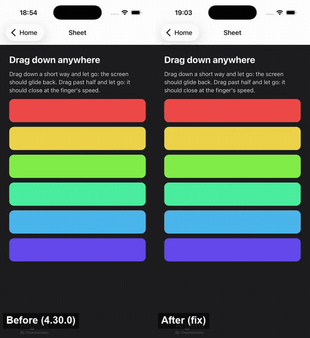

# screens-interactive-pop-release

**Library:** `react-native-screens` 4.30.0 (also `main`), through `@react-navigation/native-stack` 7.21.0
**Platform:** iOS. Any interactive pop that goes through react-native-screens' own pan recognizer and animator:
a custom `animation` with `animationMatchesGesture: true`, or `fullScreenGestureEnabled: true`.

```ts
{
  animation: 'slide_from_bottom',
  animationDuration: 250,
  animationMatchesGesture: true,
  gestureDirection: 'vertical',
  fullScreenGestureEnabled: true,
}
```

## Steps

1. Open **screens-interactive-pop-release**, then **Open the sheet-like screen**.
2. Drag down a short way (about 10–15% of the screen) and let go.

## Expected

The screen glides back over the transition's duration, starting at the finger's speed.

## Actual

It snaps back in one frame. Measured on a 30 fps recording (iPhone 17 simulator, iOS 26.5), offset of
the first stripe in pt, one value per frame:

| Release | Before | After (`fix/screens-interactive-pop-release`) |
| --- | --- | --- |
| slow drag to ~84 pt, release at rest | 84 → **0** | 84 → 81 → 51 → 25 → 10 → 4 → 1 → 0 |
| slow drag to ~103 pt, release at rest | 89 → **0** | 103 → 89 → 47 → 19 → 8 → 3 → 1 → 0 |
| quick flick to ~55 pt | 44 → **0** | 55 → 37 → 17 → 7 → 3 → 1 → 0 |



## Why

`-[RNSPercentDrivenInteractiveTransition finalizeInteractiveTransitionWithAnimationWasCancelled:]`
completes the transition with:

```objc
[animator pauseAnimation];
[animator setReversed:shouldReverseAnimation];
[animator continueAnimationWithTimingParameters:timingParams durationFactor:(1 - animator.fractionComplete)];
```

- The spring starts from rest. The finger's velocity is never passed in.
- After `setReversed:YES`, `1 - fractionComplete` is the part of the transition the screen did *not*
  travel. For a 12% cancel the 12% left is replayed with a duration factor near 0, so it completes in a frame or two.
