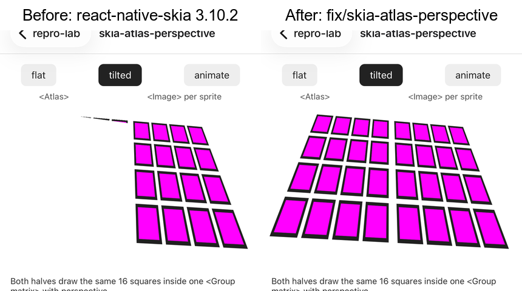

# skia-atlas-perspective

An `<Atlas>` drawn under a matrix with perspective loses parts of its sprites. They are cut along their
diagonal or missing, while the same sprites drawn as `<Image>`s under the same matrix are whole.

**Versions:** `react-native-skia` 3.10.2 (Graphite), `react-native-webgpu` 0.21.4 (same Dawn, 158.0.0),
React Native 0.88.0, Expo 58.0.16, Reanimated 4.7.1. Reproduces on 3.9.0 and later, and on `main`. 3.8.x draws it correctly.
**Platforms:** iOS (checked on the iPhone 17 simulator, iOS 26.5). Android is expected to behave the same,
since the cause is in Skia Graphite, but it was not run here.

## Steps

1. `bun install && npx expo run:ios`.
2. Open **skia-atlas-perspective**, or `reprolab://demo/skia-atlas-perspective`.
3. One `<Canvas>` holds one `<Group matrix={…}>`, a 3x3 matrix with perspective: a plane tilting away,
   with its far edge shorter. Inside it are 16 opaque squares drawn with `<Atlas>` (left half) and the same
   16 squares drawn as `<Image>`s (right half).
4. Tap **flat**, **tilted** or **animate**. Animate tilts the plane back and forth over 2 s.

## Expected

The left half matches the right half at every tilt. This is what react-native-skia 3.8.x draws.

## Actual

- **flat:** both halves are identical.
- **tilted / animate:** the atlas half is cut or gone. On this matrix only a sliver along its top edge is
  left; milder perspectives cut each square along its diagonal. The image half is whole.

| Before (3.10.2) and after (`fix/skia-atlas-perspective`), tilted |
| --- |
|  |

Video, the same animation on both builds (two separate recordings, not frame-synchronised):
[skia-atlas-perspective-before-after.mp4](../../media/skia-atlas-perspective-before-after.mp4)

## Why

- Since 3.9.0 (wcandillon/react-native-skia#4379), an atlas is drawn as one `drawVertices` call, two
  triangles per sprite (`drawAtlasAsVertices`, `packages/skia/cpp/rnskia/RNSkAtlas.h`).
- Skia Graphite's vertices render step (`src/gpu/graphite/render/VerticesRenderStep.cpp`, `vertexSkSL`)
  writes `devPosition.z = depth;` without multiplying it by `devPosition.w`. Graphite's other render steps
  write `depth * w`. This is the same on `chrome/m152`, `m157`, `m158` and Skia `main`.
- Under a perspective matrix `w != 1`. After the perspective divide, the depth varies across each triangle,
  and the depth test drops part of it.
- `SkCanvas::drawAtlas` draws each sprite with a render step that handles perspective.

Branch `fix/skia-atlas-perspective` (only `patches/react-native-skia@3.10.2.patch`): `drawAtlasAsVertices`
calls `SkCanvas::drawAtlas` when the canvas matrix has perspective.
