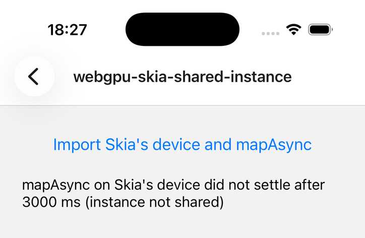
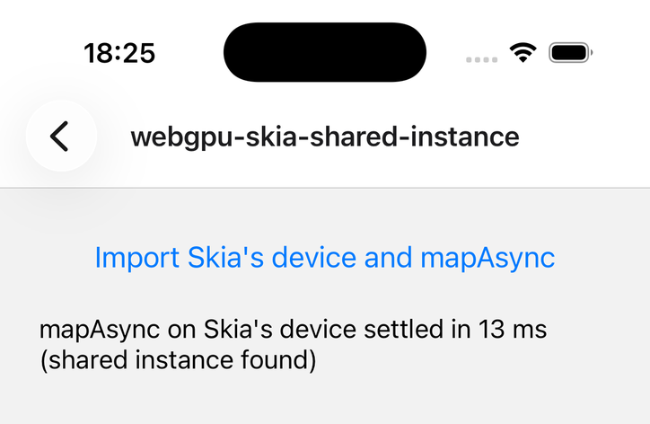
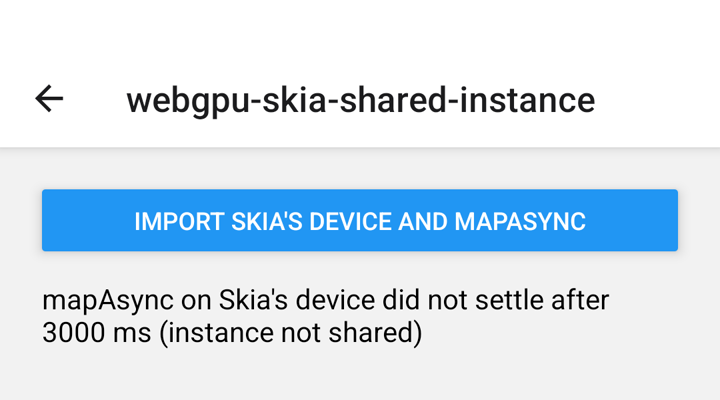
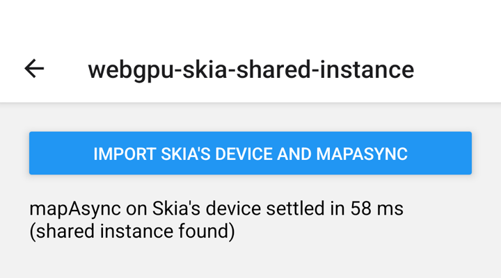

# webgpu-skia-shared-instance

**Libraries:** `react-native-skia` 3.7.2 (Graphite) + `react-native-webgpu` 0.17.0 (also `main` of both)
**Platforms:** iOS and Android. Two causes, one per platform.

## Steps

1. `bun install && npx expo run:ios`, open **webgpu-skia-shared-instance**.
2. Tap **Import Skia's device and mapAsync**. The demo imports Skia's GPU device into WebGPU
   (`importDevice(Skia.getNativeDevice())`), creates a buffer and calls `mapAsync` on it.

## Expected

`mapAsync` settles in a few milliseconds. react-native-webgpu finds Skia's Dawn instance with
`dlsym(RTLD_DEFAULT, "rnskia_getWGPUInstance")`, adopts it, and its async pump serves Skia's device.

## Actual

`mapAsync` never settles (the demo gives up after 3 s). `rnskia_getWGPUInstance` is not in the app binary:

```sh
nm .../libreact-native-skia.a | grep rnskia_getWGPUInstance     # T _rnskia_getWGPUInstance
dyld_info -exports .../reprolab.app/reprolab.debug.dylib | grep -c rnskia_getWGPUInstance   # 0
```

The function is the only symbol of `cpp/rnskia/RNDawnInterop.cpp`, and nothing references it. The linker
only loads an object file from a static library when it resolves an undefined symbol, so
`RNDawnInterop.o` is never linked. `__attribute__((visibility("default")))` does not change that.
react-native-webgpu then creates its own instance, and callbacks of the imported device never run.

| Before | After (`fix/webgpu-skia-shared-instance`) |
| --- | --- |
|  |  |

## Android

Same result, different cause. `librnskia.so` exports `rnskia_getWGPUInstance`
(`llvm-nm -D librnskia.so` → `T rnskia_getWGPUInstance`), but `System.loadLibrary` loads it with
`RTLD_LOCAL`, and `dlsym(RTLD_DEFAULT, …)` does not search libraries loaded that way.

| Before | After (`fix/webgpu-skia-shared-instance-android`) |
| --- | --- |
|  |  |

## Upstream

- Issue: https://github.com/wcandillon/react-native-skia/issues/4305
- PR: https://github.com/wcandillon/react-native-skia/pull/4306
- Fix branch here: `fix/webgpu-skia-shared-instance`
- Android issue: https://github.com/wcandillon/react-native-webgpu/issues/581
- Android PR: https://github.com/wcandillon/react-native-webgpu/pull/582
- Android fix branch here: `fix/webgpu-skia-shared-instance-android`
